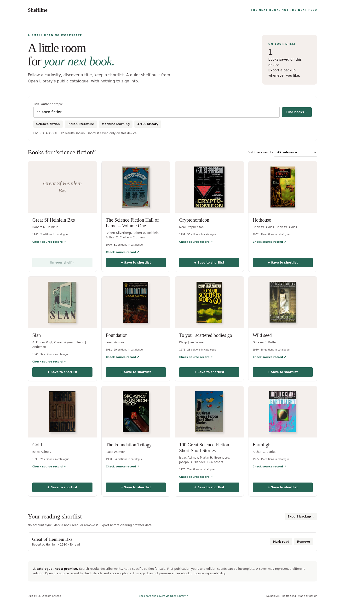
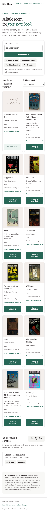

# Shelfline

### A little room for your next book.

A quiet book-discovery workspace powered by Open Library's public search and cover APIs. Search a curiosity, sort twelve candidate works, and keep an exportable reading shortlist on your device.

**Built by Er. Sangam Krishna**

[Live workspace](https://snakeeye-sudo.github.io/shelfline/) · [Search API](https://openlibrary.org/dev/docs/api/search)



<details><summary>Mobile view</summary>



</details>

## Small by design

| Feature | Behaviour |
| --- | --- |
| Discovery | One requested search returns up to 12 works with titles, authors, years, edition counts and covers |
| Sorting | API relevance, first-publication year or alphabetical order within those twelve results |
| Reading shelf | Save up to 100 works, mark read/unread, remove a work |
| Persistence | Browser localStorage only, no account or cloud sync |
| Backup | Export the shortlist as versioned JSON; import is not implemented |
| Failure states | Visible search errors, unknown metadata labels and missing-cover placeholders |

No build step. No dependencies. No paid services, API keys, telemetry or generated recommendations. The application is one static `index.html`, plus documentation and tests.

```text
User search → Open Library /search.json → 12 work records
                                        ↓
                              Local sorting + card UI
                                        ↓
                             localStorage reading shelf
                                        ↓
                                JSON backup download
```

## Run

```sh
python3 -m http.server 8000
# Open http://localhost:8000
node test.cjs
```

GitHub Pages publishes from `main` / root. Search is manual, not automatic. Responses are cached for the session and searches are throttled to at least 1.5 seconds apart. Requests omit credentials and time out after 20 seconds. Covers load lazily from Open Library, following its public-display guidance.

## Boundaries that matter

- Records describe works, not an exact purchasable edition. Cover art can represent another edition.
- First-publication years, author names and edition counts may be incomplete or wrong in the source catalogue.
- There is no promise of ebook access, public-domain status, loan availability or a price.
- Sorting changes only the returned twelve candidates, not the entire Open Library catalogue.
- Search terms and cover requests go to Open Library. Shelf contents stay on this browser unless you export them.
- Clearing browser data loses the shelf. Private browsing and disabled storage may make it temporary. Export a backup.
- This is low-volume, human-facing discovery. Do not use it for bulk harvesting or as a high-traffic commercial backend. Browser clients cannot reliably supply a custom User-Agent, so no elevated API allowance is assumed.
- No automatic fallback books are substituted after an error.

## Checks

Nine pure catalogue assertions cover key validation, missing metadata, sorting and input preservation. Local desktop/mobile live searches, saved shortlist and a 390px no-overflow layout were checked. Deployed persistence, exports and failure states are checked separately before handoff. This is not an exhaustive production, security or accessibility audit.

## Credits & licence

Application code: MIT, copyright 2026 Er. Sangam Krishna. Book metadata and covers come from [Open Library](https://openlibrary.org); each card links back to its record. Cover art remains subject to its original rights and is not relicensed under MIT. No affiliation with Open Library or Internet Archive is claimed.

[Search documentation](https://openlibrary.org/dev/docs/api/search) · [API usage guidelines](https://openlibrary.org/developers/api) · [Cover API](https://openlibrary.org/dev/docs/api/covers)
